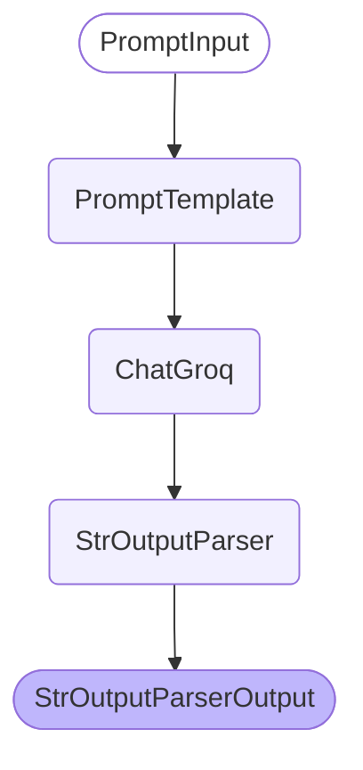
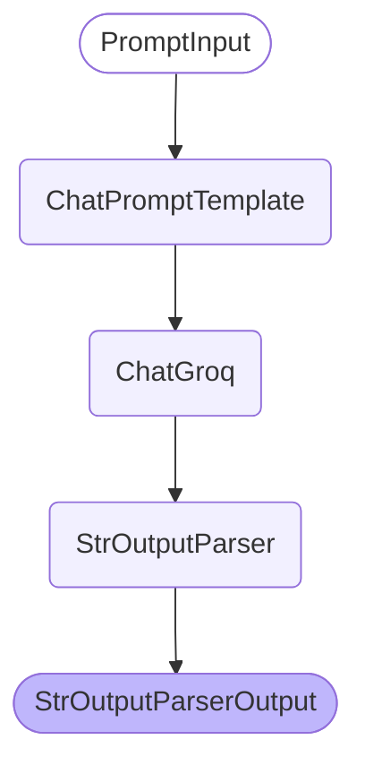
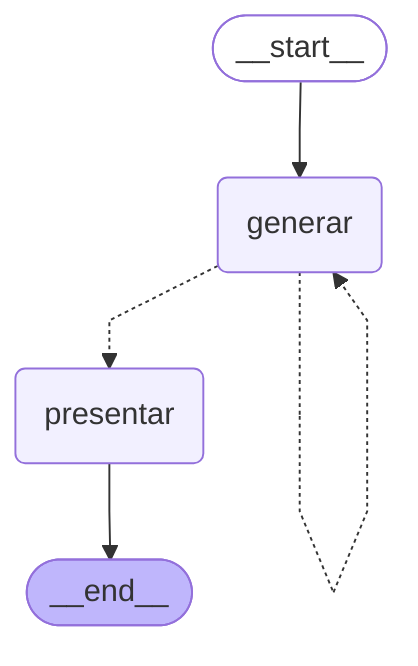

# Diagramas de los ejemplos

## Ejemplo 1: LangChain con prompt simple (langChain1.py)

## Ejemplo 2: LangChain con rol de sistema (langChain2.py)

## Ejemplo 3: LangGraph con reintento (ejemplo_3_langgraph.py)

